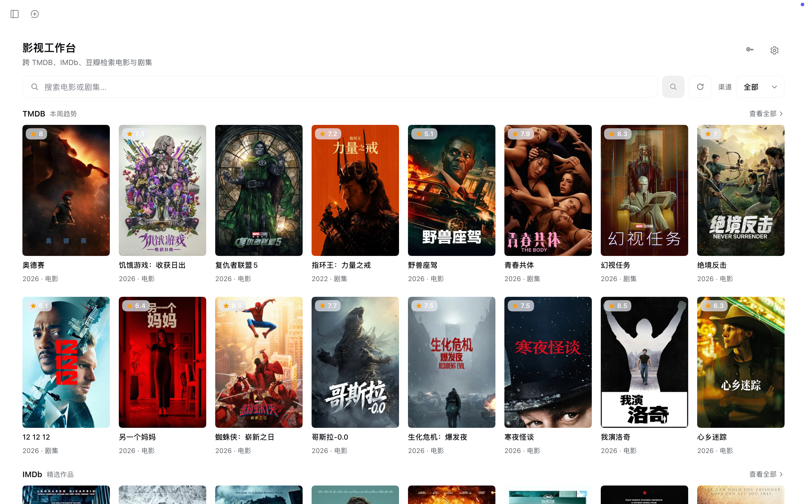
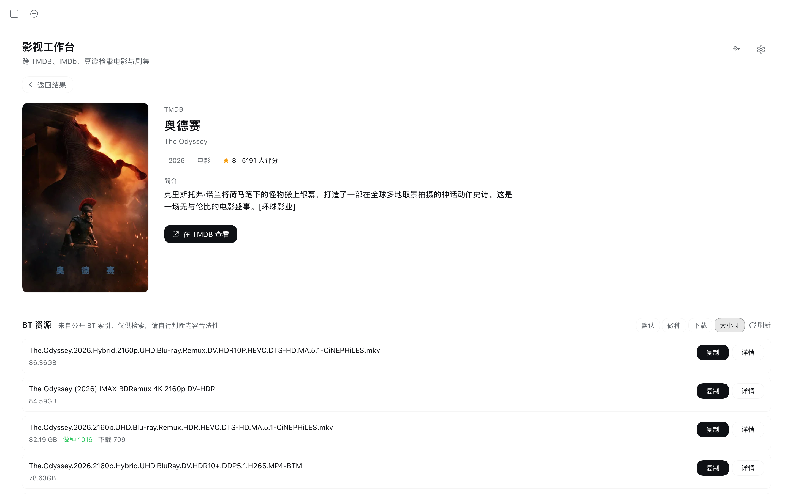
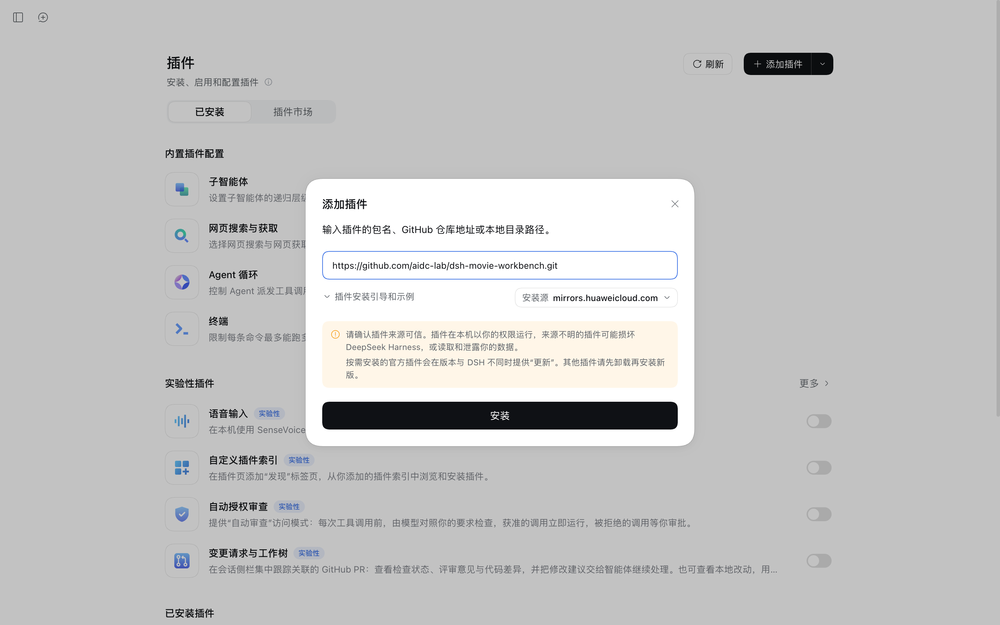

**English** | [中文](README.zh.md)

# dsh-movie-workbench

DSH **Movies workbench** : Search for movies and TV series from **TMDB**, **IMDb** and **Douban** on one page and automatically discover BT resources.

|  |   |
|------|------|

## Features

- **Multi-source search** — search TMDB, IMDb and Douban together, grouped by source.
- **Trending and channel browse** — home rows plus per-source pages with category tabs and infinite scroll.
- **Douban charts** — official, annual and genre charts for movies and TV, plus movie hidden-gem charts.
- **Detail pages** — synopsis, metadata, related titles and chart placements.
- **BT resources** — search, sort, copy magnet links and open source pages.
- **AI resource pick** — rank BT rows with the profile's model, optional preferences and an editable prompt.
- **Settings** — manage data sources, the TMDB API key and the default model in one dialog.

## Installation

### From the Plugins page

Paste the plugin's GitHub repository URL
`https://github.com/aidc-lab/dsh-movie-workbench.git` into the input field, as shown below.



### From the CLI

`dsh plugin` does the same thing as the Plugins page: it installs the package as a profile
dependency and registers the bundle. Fully quit DSH Desktop first (the `desktop` profile is
initialized by the app and cannot be used while it is running), and make sure `pnpm` is on `PATH`.

```bash
npm install -g @deepseek-ai/dsh      # provides the dsh command
dsh plugin --profile desktop add dsh-movie-workbench
```

A Git URL also works:
`dsh plugin --profile desktop add git+https://github.com/aidc-lab/dsh-movie-workbench.git`.

## Settings dialog

The gear button in the page header opens the settings dialog, which keeps every browser-side
preference in one place:

- **Data sources** — switches for TMDB, IMDb and Douban, stored in `localStorage`
  (`dsh-movie-workbench.sources`). At least one channel must stay enabled, and when only one is
  left the filter row collapses to that channel.
- **TMDB API Key** — a v3 key or a v4 read token, kept in this browser only
  (`dsh-movie-workbench.tmdb-key`). When the Host already has a key configured the field can
  stay empty.
- **Default model** — the models advertised by the profile's LLM providers (from the Host's
  `GET /models`), used by AI resource pick; the choice lives in `localStorage`
  (`dsh-movie-workbench.ai-model`). Models are only available when the DSH LLM service and a
  model are configured.

Nothing is applied until you press Save; closing the dialog with ×, Escape or a click
outside discards the edits.

## Host API

The Host side (`index.js` + `lib/`) exposes a single prefix route, `/movie-workbench/api`:

| Route | Purpose |
|---|---|
| `GET /status` | whether each channel has credentials |
| `GET /search?q=&source=&lang=` | dispatch to the selected channels and return normalized results |
| `GET /trending?source=&lang=&limit=` | recommendation rows, or a longer list for one channel |
| `GET /browse?source=&category=&page=&cursor=&lang=` | one page (20 items) of a channel browse category; returns `hasMore` and, for IMDb, an opaque `next` cursor for infinite scroll |
| `GET /charts?source=douban&kind=movie\|tv` | one chart catalog: `movie` (default) has 3 official charts with live metadata, 10 annual charts (high-score / recent-hit variants for 2025–2021), 27 hidden-gem charts (one per genre) and 54 genre charts (94 total); `tv` has 3 official, 10 annual and 54 genre charts (67 total, no hidden gems) |
| `GET /chart?source=douban&id=&start=&count=` | one page of a chart's ranked titles; `id` is an official id, `year:<yyyy>:<S or U>`, `hidden:<genre>`, `genre:<genre>:<S or U>`, or the TV forms `tv-year:<yyyy>:<S or U>` / `tv-genre:<genre>:<S or U>` (S = high-score, U = recent hits) |
| `GET /detail?source=douban\|tmdb\|imdb&id=` | synopsis and metadata (country/region, genres, runtime) for a Douban title, the collection reference of a TMDB movie, or an IMDb title's metadata |
| `GET /collection?source=tmdb&id=` | every part of a TMDB collection, as normalized movie results |
| `GET /series?source=imdb&id=` | the IMDb connection chain of one title (follows / followed by / spin-off), ordered by release year |
| `GET /chart?source=douban&id=collection:<id>` | one of the official charts a Douban title is listed in, with the same ranked envelope as other charts |
| `GET /torrents?q=&alt=&source=&limit=&page=` | BT resource search; one page of results (`page` 1–20) plus `hasMore` for scroll loading |
| `GET /models` | models advertised by the profile's LLM providers, plus the current profile selection |
| `POST /pick` | ask the Host's AI model to choose the best of up to 30 BT rows; body `{ item, rows, lang, preferences?, prompt?, preview?, model? }` (`preferences` = `{ quality, language, subtitle }`, `prompt` overrides the generated prompt, `preview: true` returns the prompt without calling a model), returns `pick` (`{id, rank, reason}`), `picks`, `prompt`, `preferences` and `errors` (`llm_unavailable` / `llm_no_model` / `bad_preferences` / `bad_prompt` / timeout) |
| `GET /image?url=` | proxy posters from allowlisted image hosts |

All upstream HTTP requests happen in the Host, so the page stays same-origin and Douban's `Referer`
requirement is handled server-side. Every route is admitted by the authenticated DSH browser
session; responses are same-origin only and carry no CORS grant.

## Configuration

Plugin configuration in `cordis.patch.yml`:

| Option | Default | Meaning |
|---|---|---|
| `tmdbApiKey` | `''` | optional server-side TMDB credential (falls back to the `TMDB_API_KEY` environment variable) |
| `maxResults` | `12` | result cap per channel |
| `requestTimeoutMs` | `8000` | timeout for a single upstream request |

TMDB needs a credential: set `tmdbApiKey`, or paste a v3 key / v4 token into the settings
dialog in the panel (stored only in the local browser). IMDb and Douban need no key.

## Development

The browser half stays in a single `client.js` because the DSH client loader expects one
classic-script registration; edit it directly, with no build step. The Host is split into
focused ES modules under `lib/host/` behind `lib/host.js`; upstream adapters live under
`lib/providers/` behind `lib/providers.js`.

| Command | Purpose |
|---|---|
| `make check` | `node --check` on every source file |
| `make smoke` | the offline client/render/pick test suite |
| `make live` | live upstream harness against TMDB, IMDb, Douban and the BT indexes |
| `make publish` | publish the package to npm (prompts for a 2FA code) |

## Notes

- Requires the DSH Web GUI and network access to TMDB, IMDb, Douban, BT4G, BitSearch and the poster hosts.
- IMDb search results have no rating; Douban recommendations include the public `rate`; TMDB returns ratings and votes.
- Some upstream endpoints are undocumented and may change or rate-limit; failures are isolated per channel.
