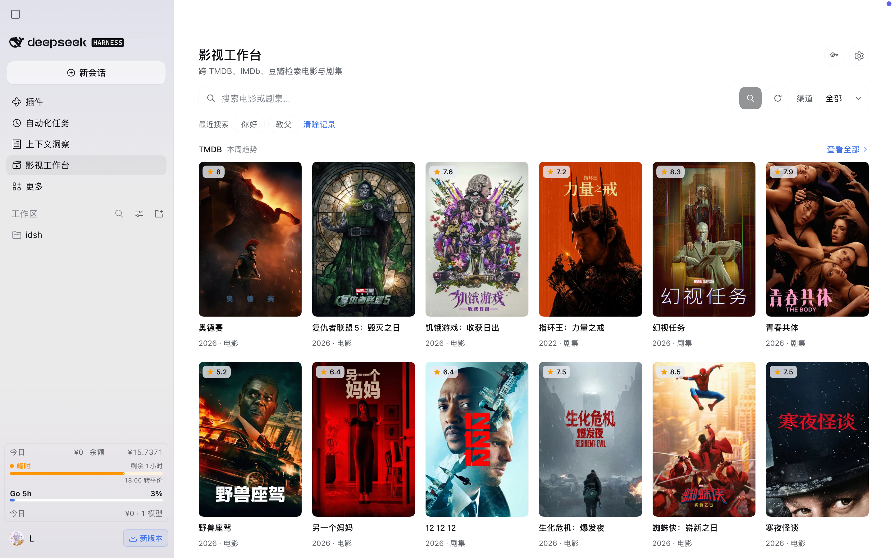
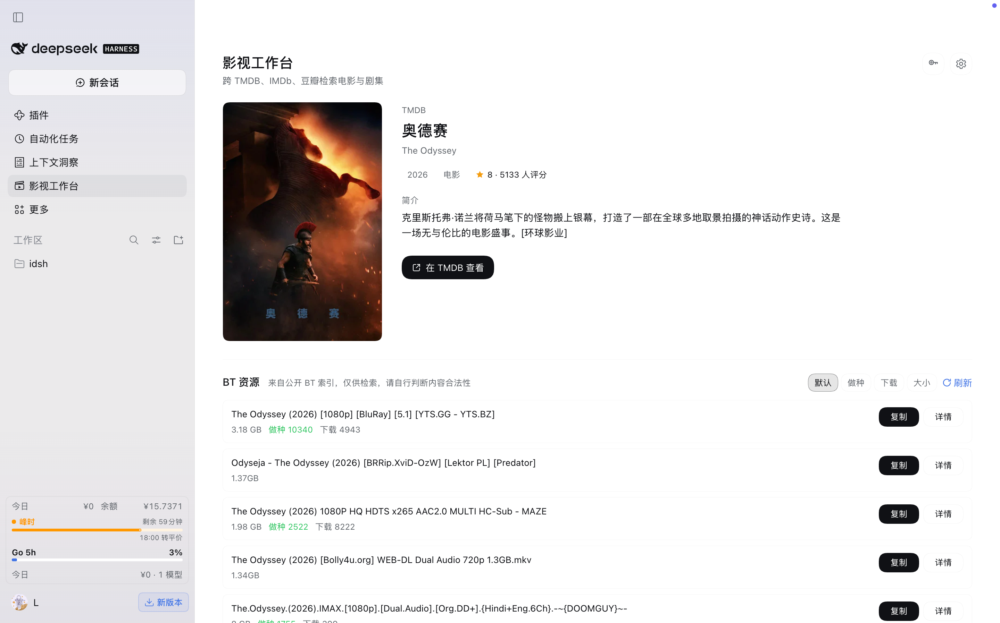
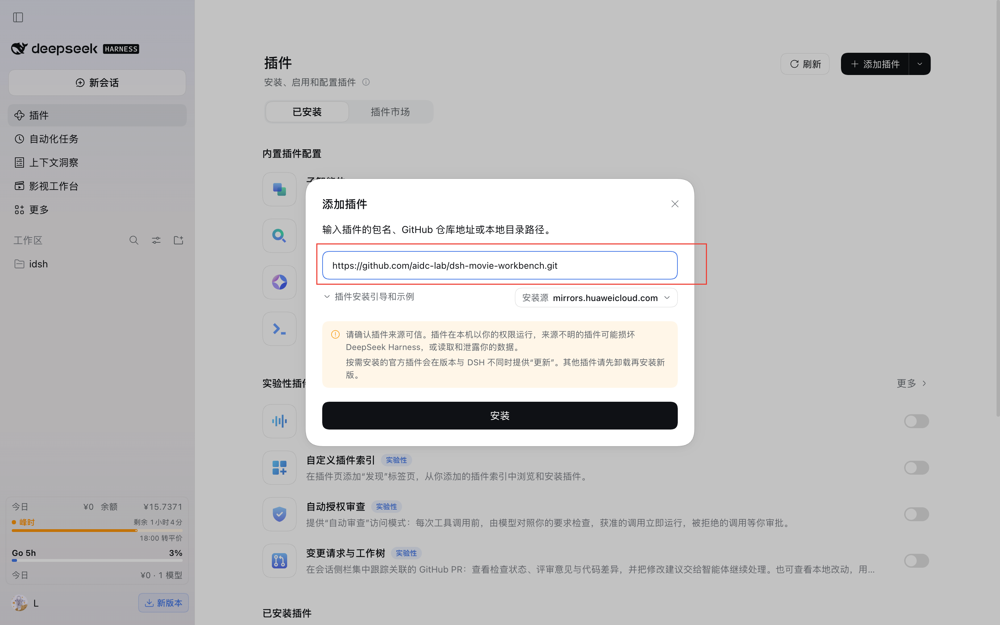

[English](README.md) | **简体中文**

# dsh-movie-workbench

一个 DeepSeek Harness 插件，在左侧栏加入 **影视工作台 / Movies workbench** 面板：
在一个页面里检索 **TMDB**、**IMDb** 和 **豆瓣** 的电影与剧集，可以查找 BT 资源。





## 功能

- **影视搜索** — 结果按渠道分组，含海报、年份、评分与来源链接。
- **热门推荐** — 展示各渠道热门推荐影视。
- **BT 资源** — 查找 BT 资源，可按大小、做种、下载排序；可复制磁力链接或打开来源页。

## 安装

### 通过插件页面

直接将插件的GitHub仓库地址 `https://github.com/aidc-lab/dsh-movie-workbench.git` 拷贝到输入框中，如下图。



### 通过命令行

`dsh plugin` 与插件页面做的是同一件事：把包装进 profile 依赖并注册 bundle。运行前请
先完全退出 DSH Desktop（`desktop` profile 由应用初始化，运行期间不能被占用），并确保
`pnpm` 在 `PATH` 中。

```bash
npm install -g @deepseek-ai/dsh      # 提供 dsh 命令
dsh plugin --profile desktop add dsh-movie-workbench
```

也支持 Git URL：`dsh plugin --profile desktop add
git+https://github.com/aidc-lab/dsh-movie-workbench.git`。

## 数据源设置

页头 TMDB Key 按钮旁的齿轮按钮打开数据源开关。选择保存在 `localStorage`
（`dsh-movie-workbench.sources`）；至少保留一个渠道，只剩一个时筛选行收起到该渠道。

## Host API

Host 端（`index.js` + `lib/`）只有一个前缀路由 `/movie-workbench/api`：

| 路由 | 用途 |
|---|---|
| `GET /status` | 各渠道是否已配置凭据 |
| `GET /search?q=&source=&lang=` | 分发到所选渠道并返回归一化结果 |
| `GET /trending?source=&lang=&limit=` | 推荐行，或单个渠道的更长列表 |
| `GET /detail?source=douban&id=` | 豆瓣条目的简介与元数据 |
| `GET /torrents?q=&alt=&source=&limit=` | BT 资源搜索 |
| `GET /image?url=` | 代理白名单图床的海报 |

所有上游 HTTP 请求都在 Host 完成，因此页面保持同源，豆瓣的 `Referer` 要求也在服务端
处理。

## 配置

`cordis.patch.yml` 中的插件配置：

| 配置项 | 默认值 | 含义 |
|---|---|---|
| `tmdbApiKey` | `''` | 可选的服务端 TMDB 凭据（回退到 `TMDB_API_KEY` 环境变量） |
| `maxResults` | `12` | 每个渠道的结果上限 |
| `requestTimeoutMs` | `8000` | 单个上游请求超时 |

TMDB 需要凭据：可设置 `tmdbApiKey`，或在面板的 Key 控件里粘贴 v3 Key / v4 令牌
（只保存在本机浏览器）。IMDb 与豆瓣无需 Key。

## 说明

- 需要 DSH Web GUI（提供 `ctx.webServer`），并能访问
  `api.themoviedb.org`、`v2.sg.media-imdb.com`、`movie.douban.com`、`bt4gprx.com`、
  `bitsearch.to` 及海报图床。
- IMDb 搜索结果没有评分；豆瓣推荐带公开的 `rate`；TMDB 提供评分与票数。
- suggestion、rexxar、BT4G 与 BitSearch 都是未公开接口，可能变更或限流；失败时按渠道
  单独提示，不影响其他渠道。
