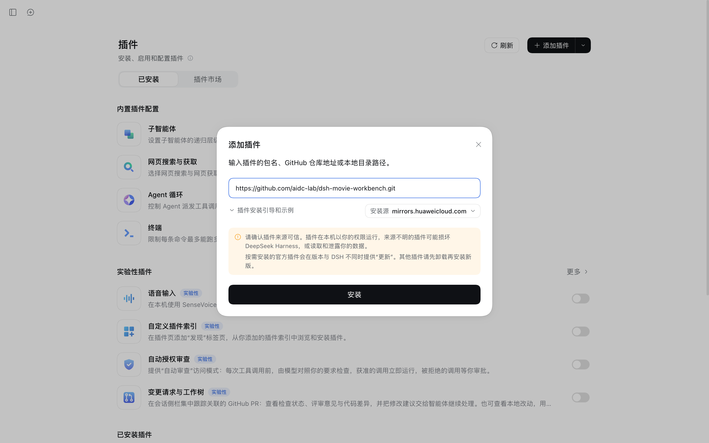

[English](README.md) | **简体中文**

# dsh-movie-workbench

DSH **影视工作台**：在一个页面里检索 **TMDB**、**IMDb** 和 **豆瓣** 的电影与剧集，自动发现 BT 资源。

|  |   |
|------|------|

## 功能

- **影视搜索** — 结果按渠道分组，含海报、年份、评分与来源链接。
- **热门推荐** — 首页展示各渠道热门推荐影视；每行数量随面板宽度自适应，正好铺满两行，窗口尺寸变化时自动重新请求。
- **渠道浏览** — 点进渠道进入独立页面，按分类标签切换（TMDB：本周趋势 / 电影 / 剧集；
  IMDb：精选作品 / 电影 / 剧集；豆瓣：热门推荐 / 电影 / 剧集 / 电影榜单 / 剧集榜单），下滑自动加载下一页。
- **豆瓣榜单** — 豆瓣渠道页有「电影榜单」和「剧集榜单」两个标签，分组均可折叠。电影榜单包含
  官方榜单、年度榜单（2025–2021，含高分/热门两档）、高分经典（27 个类型）、近期热门（27 个类型）和
  冷门佳作（27 个类型）；剧集榜单包含官方榜单、年度榜单和高分经典 / 近期热门。
  无封面的榜单自动取第一名作品的封面，点开榜单按排名展示影片，同样支持下滑加载更多。
- **详情页的相关卡片** — TMDB 合集、IMDb 相关系列、豆瓣收录于榜单统一放在详情页右侧栏，
  显示为同一款紧凑卡片（封面 + 名称 + 一行说明）：TMDB 合集进入合集页，IMDb 相关系列
  按上映年份浏览全部相关作品，豆瓣的每个榜单卡片直接打开该榜单的排名影片。中间正文与简介
  占满剩余宽度，面板较窄时右侧栏自动落到正文下方。
- **详情元数据** — 详情页在评分标签下显示国家/地区、分类与片长：豆瓣来自条目接口，
  TMDB 来自电影详情接口，IMDb 来自其浏览器 GraphQL 接口。
- **BT 资源** — 查找 BT 资源，可按大小、做种、下载排序，支持下滑/「加载更多」分页；
  可复制磁力链接或打开来源页。

## 安装

### 通过插件页面

直接将插件的GitHub仓库地址 `https://github.com/aidc-lab/dsh-movie-workbench.git` 拷贝到输入框中，如下图。



### 通过命令行

`dsh plugin` 与插件页面做的是同一件事：把包装进 profile 依赖并注册 bundle。运行前请
先完全退出 DSH Desktop（`desktop` profile 由应用初始化，运行期间不能被占用），并确保
`pnpm` 在 `PATH` 中。

```bash
npm install -g @deepseek-ai/dsh      # 提供 dsh 命令
dsh plugin --profile desktop add dsh-movie-workbench
```

也支持 Git URL：`dsh plugin --profile desktop add
git+https://github.com/aidc-lab/dsh-movie-workbench.git`。

## 数据源设置

页头 TMDB Key 按钮旁的齿轮按钮打开数据源开关。选择保存在 `localStorage`
（`dsh-movie-workbench.sources`）；至少保留一个渠道，只剩一个时筛选行收起到该渠道。

## Host API

Host 端（`index.js` + `lib/`）只有一个前缀路由 `/movie-workbench/api`：

| 路由 | 用途 |
|---|---|
| `GET /status` | 各渠道是否已配置凭据 |
| `GET /search?q=&source=&lang=` | 分发到所选渠道并返回归一化结果 |
| `GET /trending?source=&lang=&limit=` | 推荐行，或单个渠道的更长列表 |
| `GET /browse?source=&category=&page=&cursor=&lang=` | 渠道浏览分类的一页（20 条），返回 `hasMore` 与 IMDb 的不透明 `next` 游标用于无限加载 |
| `GET /charts?source=douban&kind=movie\|tv` | 单个榜单目录：`movie`（默认）含 3 个官方榜单（实时元数据）+ 10 个年度榜单（2025–2021 的高分/热门）+ 27 个类型冷门佳作 + 54 个分类题材榜单（共 94 个）；`tv` 含 3 个官方 + 10 个年度 + 54 个分类题材榜单（共 67 个，无冷门佳作） |
| `GET /chart?source=douban&id=&start=&count=` | 某个榜单的一页按排名条目；`id` 为官方榜单 id、`year:<年份>:<S 或 U>`、`hidden:<类型>`、`genre:<类型>:<S 或 U>`，以及剧集形式 `tv-year:<年份>:<S 或 U>` / `tv-genre:<类型>:<S 或 U>`（S 高分经典，U 近期热门） |
| `GET /detail?source=douban\|tmdb\|imdb&id=` | 豆瓣条目的简介与元数据（国家/地区、分类、片长），或 TMDB 电影所属的合集信息，或 IMDb 条目的元数据 |
| `GET /collection?source=tmdb&id=` | TMDB 合集里的全部作品（归一化电影结果） |
| `GET /series?source=imdb&id=` | 单个 IMDb 条目的相关系列（前作 / 续作 / 衍生），按上映年份排序 |
| `GET /chart?source=douban&id=collection:<id>` | 豆瓣条目收录的某个官方榜单，返回结构与其他榜单一致 |
| `GET /torrents?q=&alt=&source=&limit=&page=` | BT 资源搜索；返回一页结果（`page` 1–20）及 `hasMore` 供下滑加载 |
| `GET /image?url=` | 代理白名单图床的海报 |

所有上游 HTTP 请求都在 Host 完成，因此页面保持同源，豆瓣的 `Referer` 要求也在服务端
处理。IMDb 浏览页通过 IMDb 的浏览器 GraphQL 接口做游标分页，可以一直下滑加载新条目；
首页推荐行仍使用固定精选列表，因此数量有限。

## 配置

`cordis.patch.yml` 中的插件配置：

| 配置项 | 默认值 | 含义 |
|---|---|---|
| `tmdbApiKey` | `''` | 可选的服务端 TMDB 凭据（回退到 `TMDB_API_KEY` 环境变量） |
| `maxResults` | `12` | 每个渠道的结果上限 |
| `requestTimeoutMs` | `8000` | 单个上游请求超时 |

TMDB 需要凭据：可设置 `tmdbApiKey`，或在面板的 Key 控件里粘贴 v3 Key / v4 令牌
（只保存在本机浏览器）。IMDb 与豆瓣无需 Key。

## 说明

- 需要 DSH Web GUI（提供 `ctx.webServer`），并能访问
  `api.themoviedb.org`、`v2.sg.media-imdb.com`、`movie.douban.com`、`bt4gprx.com`、
  `bitsearch.to` 及海报图床。
- IMDb 搜索结果没有评分；豆瓣推荐带公开的 `rate`；TMDB 提供评分与票数。
- IMDb 相关系列来自 IMDb 浏览器 GraphQL 的 `connections` 字段（单个条目最多 1250 条关系）；
  豆瓣收录于榜单来自条目详情里的 `subject_collections` 字段。
- 渠道浏览每页 20 条、最多 100 页；IMDb 浏览页基于精选种子列表经 suggestion API 解析，
  因此一页可能不足 20 条。
- suggestion、rexxar、BT4G 与 BitSearch 都是未公开接口，可能变更或限流；失败时按渠道
  单独提示，不影响其他渠道。
